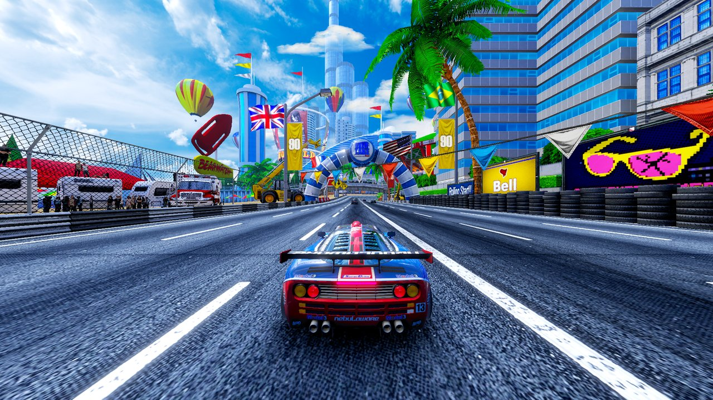
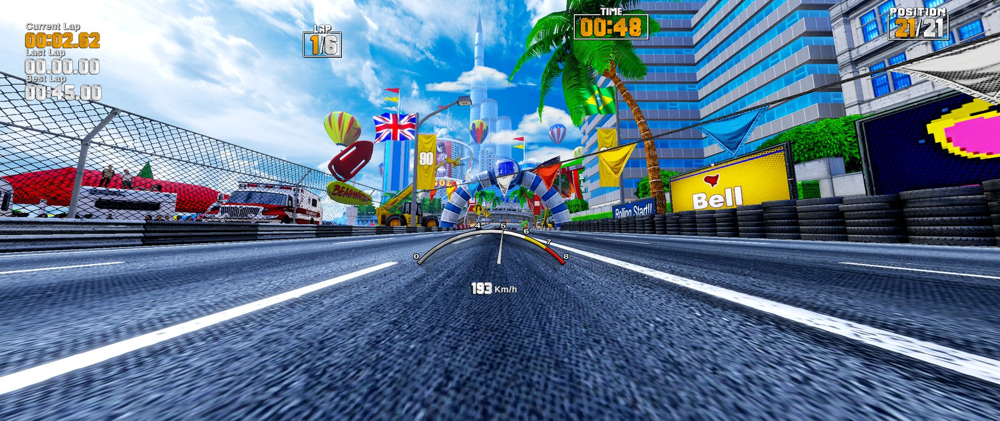
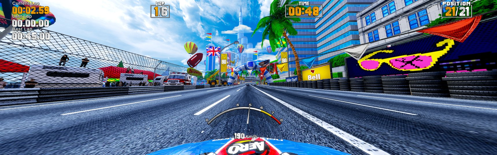
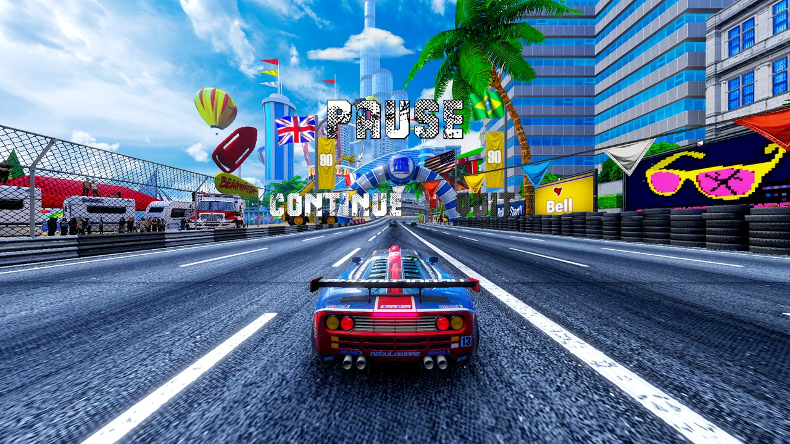

<div align="center">

# 🏁 9OsGP Extractor

**Jouez au jeu de course caché de _Takeover 2_ comme un jeu à part entière.**

Un seul `.exe` à lancer : il extrait le mini-jeu bonus *9OsGP* de votre installation de Takeover 2
et en fait un jeu autonome qui démarre directement sur la course, avec un vrai menu d'options.



[**⬇️ Télécharger la dernière version**](../../releases/latest)

</div>

---

## ✨ Fonctionnalités

| | |
|---|---|
| 🚀 **Démarrage direct** | Plus d'intro ni de menus Takeover 2 : la course démarre en quelques secondes, et vous restez dedans après l'arrivée. |
| 🎥 **Nouvelles vues caméra** | Poursuite (vue d'origine), **Capot** et **Intérieure sans capot** (caméra au pare-chocs). |
| 🖥️ **Affichage** | Plein écran, plein écran fenêtré ou fenêtré, au choix de la résolution. |
| 🎨 **Graphismes** | Activez ou coupez le bezel de borne d'arcade, l'effet CRT, les contours noirs (cel shading), le post-traitement BD et la trame halftone sur les éclairages. |
| 🕹️ **Ambiance borne d'arcade** | Présentation de la voiture avant le départ (trois plans qui se rapprochent, puis votre vue de course pour le compte à rebours), voiture immobilisée pendant le décompte, et après la course : replay, GAME OVER, transition à points noirs, puis « PRESS START ». |
| 🎬 **Replay** | Après la course, la course est rejouée avec ses effets (fumée, terre, étincelles, flammes, feux de freins) et un réalisateur automatique : caméras TV au bord de la piste, poursuite, hélico, capot… Le dernier replay se revoit à tout moment avec **F9**. |
| 🏁 **Styles de dérapage** | Origine, **Ridge Racer**, **OutRun 2** ou **Daytona / Scud Race** : entrée, tenue et sortie de glisse comme dans ces jeux. |
| 🏆 **Classement** | Les 10 meilleurs temps, sauvegardés, affichés en fin de course et dans l'attract ; un nouveau record se signe en 3 lettres sur une roue de lettres. |
| 🔊 **Audio** | Volumes général, musique, moteurs et effets, de 0 à 200 %. Bande-son au choix : la musique d'origine ou vos propres fichiers mp3 / ogg / wav (un morceau ou tous au hasard). |
| 🌍 **5 langues** | Menu d'options en English, Español, Français, Deutsch et Português BR (les langues de Takeover 2). |
| ⏸️ **Menu Pause épuré** | Fond transparent pour garder la course visible, entrée OPTIONS retirée (le menu F1 la remplace). |
| 📊 **HUD personnalisable** | Compteur de vitesse déplaçable et redimensionnable à part, autres infos remontables, plaquées aux bords en écran large, ou masquées bloc par bloc. |
| 🎮 **Contrôles** | Réassignation des touches clavier et manette. |
| 🏎️ **Volant et pédalier** | Assistant de configuration (direction, accélérateur et frein progressifs, boutons) et **retour de force** DirectInput. |
| 🧩 **Non destructif** | Votre installation de Takeover 2 n'est jamais modifiée : tout est copié dans un nouveau dossier. |

<div align="center">

## 📸 Vues et HUD selon la résolution

Le HUD s'adapte au format de l'écran : les infos se plaquent contre les bords et le compteur se place à part.

<br>
<sub>Vue extérieure — 1920×1080 (16:9)</sub>

<br>
<sub>Vue intérieure sans capot — 2560×1080 (21:9)</sub>

<br>
<sub>Vue capot — 3440×1080 (32:10)</sub>

<br>
<sub>Menu Pause : fond transparent, sans l'entrée OPTIONS</sub>

</div>

## 📦 Installation

> **Prérequis :** posséder **Takeover 2** et l'avoir installé (Windows 64 bits).
> Aucun fichier du jeu n'est fourni ici : l'extracteur se sert de **votre** copie.

1. Téléchargez `9OsGP_Extractor.exe` depuis la page [**Releases**](../../releases/latest).
2. Lancez-le. Il trouve le jeu tout seul s'il est placé **dans le dossier de Takeover 2** (à côté de `Takeover2.exe`).
   Sinon, il vous demande le chemin.
3. Patientez pendant la copie (environ **5,5 Go**, il faut donc cet espace libre).
4. Lancez **`9OsGP_Racing\9OsGP.exe`**, créé à côté du dossier du jeu.

Usage en ligne de commande :

```powershell
9OsGP_Extractor.exe "C:\Chemin\Vers\Takeover 2" "D:\Jeux\9OsGP_Racing"
```

Relancer l'extracteur met à jour une extraction existante : seuls les fichiers modifiés sont recopiés.

## 🎮 En jeu

| Touche | Action |
|---|---|
| **F1** | Ouvrir / fermer le menu d'options (le jeu se met en pause) |
| **C** · manette **Y** / **Select** · bouton du volant au choix | Changer de vue : Poursuite → Capot → Intérieure sans capot |
| **F9** (écran « PRESS START ») | Revoir le dernier replay |
| **Échap** | Fermer le menu d'options, sinon proposer de quitter le jeu |

### Menu d'options

- **Affichage** : langue, mode d'affichage, résolution.
- **Graphismes** :
  - Bezel (cadre de la borne d'arcade)
  - Effet écran CRT
  - Contours noirs (cel shading)
  - Post-traitement BD
  - Trame BD sur les éclairages
- **Caméra** : choix de la vue, replay, présentation de la voiture avant le départ. Pour les vues intérieures, réglage du champ de vision, de la hauteur, de la position avant/arrière et de l'inclinaison.
- **HUD** :
  - **Compte-tours et vitesse** : taille, position horizontale et verticale, placement en bas de l'écran en vue capot / intérieure.
  - **Autres informations** (temps, tour, position, temps au tour) : taille, hauteur, écartement horizontal et vertical (à 1, les blocs sont plaqués contre les bords en 16:9 / 21:9), marge aux bords.
  - Affichage ou masquage de chaque bloc, messages compris (départ, checkpoint, contresens).
- **Audio** : volumes de 0 à 200 % (général, musique, moteurs, effets sonores ; 100 % = volume d'origine, au-delà le son est amplifié, pratique pour le moteur, discret dans le jeu d'origine) et bande-son. Pour utiliser vos propres musiques, placez des fichiers mp3, ogg ou wav dans un dossier `Music` à côté de `9OsGP.exe` : ils apparaissent dans la liste, avec un mode aléatoire dès qu'il y en a plusieurs.
- **Gameplay** : style de dérapage (voir ci-dessous).
- **Contrôles** : réassignation clavier et manette, et retour aux valeurs par défaut. L'onglet **Volant / pédalier** est détaillé ci-dessous.

Les réglages sont enregistrés dans `9OsGP_settings.ini`, à côté de `9OsGP.exe`. Ils sont réappliqués au lancement, même si le jeu d'origine tente de remettre son propre mode d'affichage.

### 🎬 Replay

Pendant la course, la position de toutes les voitures (carrosserie, roues) est enregistrée 30 fois par seconde. Après l'arrivée (ou un Game Over), la course est rejouée en boucle, comme sur une borne d'arcade :

- **Réalisation automatique** : plans TV au bord de la piste qui suivent la voiture avec un zoom, poursuite, hélico, vue avant, vue de côté et vue capot.
- **Effets** : fumée de dérapage, terre, étincelles, flammes d'échappement et feux de freins sont enregistrés et rejoués.
- **Plans propres** : les caméras restent le long de la route parcourue par les voitures, et un plan est coupé si un obstacle s'interpose.
- **Enchaînement** : la course terminée, le replay démarre directement. START ou l'accélérateur affiche le GAME OVER du jeu sur fond assombri, puis la transition à points noirs mène à l'écran « PRESS START ».
- **Revoir le dernier replay** : **F9** sur l'écran « PRESS START ». Il est enregistré dans `last_replay.rbr` et reste disponible après avoir quitté le jeu.
- **Désactivation** : dans **F1 › Caméra › Replay de la course**.

### 🚦 Départ

Après START, trois plans se rapprochent de la voiture, puis la caméra rejoint votre vue de course (poursuite, capot ou intérieure), sur laquelle se joue le compte à rebours (désactivable dans **F1 › Caméra**). Le jeu continue de tourner pendant ces plans (confettis, public). Pendant le décompte, la voiture reste sur la grille : on peut faire monter le moteur dans les tours, mais pas partir avant le GO.

### 🏁 Styles de dérapage

Dans **F1 › Gameplay** :

| Style | Entrée en glisse | Pendant la glisse | Sortie |
|---|---|---|---|
| **Origine** | Frein maintenu + braquage à fond au-dessus de 150 km/h | Glisse d'origine du jeu | Relâcher le frein |
| **Ridge Racer** | Lâcher l'accélérateur un moment puis un coup de volant (ou, en braquant : lâcher, coup de frein, regaz, aussi vite que vous voulez) | La voiture glisse en biais ; le volant ouvre ou referme l'angle, la trajectoire suit l'angle | Remettre la voiture droite : elle reprend son grip. La faire passer de l'autre côté enchaîne une nouvelle glisse |
| **OutRun 2** | Plus facile : un coup de volant avec un coup de frein ou un bref lâcher, l'accélérateur peut rester enfoncé | Comme Ridge Racer | Comme Ridge Racer |
| **Daytona / Scud Race** | Appel puis contre-appel du volant (d'un côté puis vivement de l'autre), avec un coup de frein ou un lâcher | L'angle se referme de lui-même dès qu'on ne braque plus dans le virage | La voiture retrouve son grip plus facilement |

Dans tous les styles, un choc (mur, voiture) met fin à la glisse.

### 🏆 Classement

Les 10 meilleurs temps de course (du GO à l'arrivée, avec le meilleur tour) sont enregistrés dans `9OsGP_ranking.txt`, à côté de `9OsGP.exe`. Le tableau s'affiche à la fin de chaque course terminée et dans l'attract (pendant le replay et sur l'écran « PRESS START »).

Un nouveau record ouvre la saisie du nom, comme sur une borne : une roue de lettres que l'on fait tourner au volant, au stick ou aux flèches, en validant chaque lettre avec l'accélérateur, START ou Entrée. Le frein efface, `END` termine, et le clavier permet aussi de taper directement. Au bout de 30 secondes, le nom est validé tel quel.

### 🏎️ Volant, pédalier et retour de force

Le jeu d'origine ne prévoit que la manette : sans configuration, un volant ne fait rien. Dans **F1 › Contrôles › Volant / pédalier**, choisissez votre volant puis lancez l'assistant :

1. Pédales relâchées.
2. Tournez le volant à fond à droite.
3. Tournez le volant à fond à gauche : le centre est calculé entre les deux butées.
4. Enfoncez l'accélérateur à fond.
5. Enfoncez le frein à fond.
6. Choisissez le bouton pour changer de vue (facultatif).
7. Choisissez le bouton pour ouvrir le menu (facultatif).
8. Choisissez le bouton START, pour lancer une course et mettre en pause (facultatif).

Bon à savoir :

- Les axes sont détectés et calibrés automatiquement : position de repos, pédales inversées, accélérateur et frein sur un axe commun.
- Les pédales sont **progressives**. Le frein déclenche aussi le drift, comme la gâchette gauche de la manette.
- Le volant n'est utilisé que par ces réglages : ses boutons ne déclenchent plus la pause du jeu par erreur.
- Réglages disponibles : **sensibilité de la direction** (2 = braquage maximal à mi-course, pratique pour les volants 900°), zone morte des pédales, inversion de la direction, et un bouton pour **recentrer** le volant. Seuls les axes utilisés sont affichés en direct.
- **Retour de force** (DirectInput) : rappel au centre qui se durcit avec la vitesse, poids du volant à l'arrêt, forces latérales en glisse et à-coups lors des chocs. Force générale, rappel au centre et effets se règlent séparément, et le sens peut être inversé. La ligne « État » indique quel volant est utilisé.

### 💡 Sorties façon MAME (bornes d'arcade)

Le jeu publie l'état des voyants exactement comme MAME, pour que MameHooker, LEDBlinky ou DOFLinx pilotent les boutons lumineux d'une borne. Les deux modes de sortie de MAME sont proposés en même temps :

- **messages Windows** (mode par défaut de ces logiciels) : fenêtre `MAMEOutput` et messages `MAMEOutputStart`, `MAMEOutputRegister`, `MAMEOutputUpdateState`… ;
- **réseau** : port TCP 8000, IPv4 et IPv6, `mame_start = 9osgp` puis des lignes `nom = valeur`.

Sorties :

- `start_lamp` : clignote pendant l'attract (replay, GAME OVER, « PRESS START »), éteint en course ;
- `view_lamp` : allumé pendant la course.

Désactivable dans **F1 › Contrôles › Volant / pédalier**.

## 🔧 Comment ça marche

L'extracteur ne modifie aucun code du jeu. Il :

1. copie le moteur Unity et les données de Takeover 2 dans un nouveau dossier, avec l'exécutable renommé `9OsGP.exe` ;
2. ajoute un petit module, **RaceBoot.dll**, et le déclare dans `ScriptingAssemblies.json` et `RuntimeInitializeOnLoads.json` pour qu'Unity le charge au démarrage ;
3. vérifie au passage l'intégrité du fichier `unity default resources`.

**RaceBoot** fait le reste au lancement :

- il redirige vers la scène de course `Bonus_9OsGP` ;
- il dessine le menu d'options (IMGUI) ;
- il pilote les features du pipeline URP (contours, Beautify), les volumes de post-process (CRT, intensité de la « lens dirt » du bloom) et la caméra ;
- il repositionne les blocs du canvas `90sGP_canvas/in_game` du HUD ;
- pour le replay, il enregistre les poses des voitures et en garde des copies purement visuelles (sans physique ni scripts), rejouées sur l'écran titre avec sa propre caméra ;
- il remet le chrono de course à 50 s à chaque départ (le jeu d'origine le laissait tourner sur l'écran titre) ;
- il coupe les caméras de débogage laissées actives sur chaque voiture de l'IA, qui calculaient l'image de toute la scène pour rien ;
- il s'appuie sur Rewired pour la réassignation des contrôles. Pour un volant, il crée une configuration et une calibration d'axes dédiées : la voiture lit les actions `steer`, `handgun` (accélérateur) et `run` (frein / drift) en analogique ;
- il pilote le retour de force par appels DirectInput 8 directs (ressort, amortisseur, force constante), sans dépendance externe.

## 🛠️ Compiler soi-même

Prérequis : [.NET SDK 8](https://dotnet.microsoft.com/download).

```text
RaceBoot/     Module injecté dans le jeu (netstandard2.1, référence les DLL du jeu)
Extractor/    L'extracteur (net8.0, exe autonome en un seul fichier)
```

**1. RaceBoot**

Cette étape nécessite Takeover 2 installé, car le projet référence ses DLL dans `Takeover2_Data\Managed`.

```powershell
dotnet build RaceBoot -c Release -o RaceBoot/out -p:GameManaged="C:\Chemin\Vers\Takeover 2\Takeover2_Data\Managed"
Copy-Item RaceBoot/out/RaceBoot.dll Extractor/Resources/
```

Une copie précompilée de `RaceBoot.dll` est déjà présente dans `Extractor/Resources`. Vous pouvez sauter cette étape si vous ne modifiez que l'extracteur.

**2. Extracteur**

```powershell
dotnet publish Extractor -c Release -o dist
```

## ❓ Dépannage

- **Le jeu plante au démarrage** : l'extracteur signale si `unity default resources` est corrompu.
  Sur Steam, faites *Propriétés › Fichiers installés › Vérifier l'intégrité des fichiers*, puis relancez l'extracteur.
- **Le volant ne répond pas** : relancez l'assistant dans *Contrôles › Volant / pédalier* et vérifiez que les axes bougent dans « Axes en direct ».
- **Le retour de force tire dans le mauvais sens** : activez « Inverser le sens des forces ».
- **La fenêtre est trop grande** : passez en mode *Fenêtré* dans F1 › Affichage, ou supprimez `9OsGP_settings.ini` pour revenir aux réglages par défaut.

## ⚖️ Avertissement

Projet de fan, non officiel, sans lien avec les développeurs ou éditeurs de *Takeover 2*.
Aucun contenu du jeu n'est distribué : il faut posséder le jeu.
Le code source de ce dépôt est sous [licence MIT](LICENSE).
