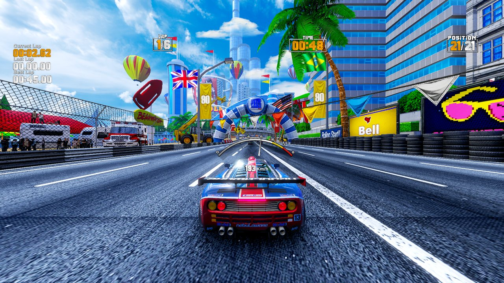

<div align="center">

# 🏁 9OsGP Extractor

**Jouez au jeu de course caché de _Takeover 2_ comme un jeu à part entière.**

Un seul `.exe` à lancer : il extrait le mini-jeu bonus *9OsGP* de votre installation de Takeover 2
et en fait un jeu autonome qui démarre directement sur la course, avec un vrai menu d'options.


[**⬇️ Télécharger la dernière version**](../../releases/latest)

</div>

---

## ✨ Fonctionnalités

| | |
|---|---|
| 🚀 **Démarrage direct** | Plus d'intro ni de menus Takeover 2 : la course démarre en quelques secondes, et vous restez dedans après l'arrivée. |
| 🎥 **Nouvelles vues caméra** | Poursuite (vue d'origine), **Capot** et **Intérieure sans capot** (caméra au pare-chocs). |
| 🖥️ **Affichage** | Plein écran, plein écran fenêtré ou fenêtré, au choix de la résolution. |
| 🎨 **Graphismes** | Activez ou coupez le bezel de borne d'arcade, l'effet CRT, les contours noirs (cel shading), le post-traitement BD et la trame halftone sur les éclairages. |
| ⏸️ **Menu Pause épuré** | Fond transparent pour garder la course visible, entrée OPTIONS retirée (le menu F1 la remplace). |
| 📊 **HUD personnalisable** | Compteur de vitesse déplaçable et redimensionnable à part, autres infos remontables, plaquées aux bords en écran large, ou masquées bloc par bloc. |
| 🎮 **Contrôles** | Réassignation des touches clavier et manette. |
| 🏎️ **Volant et pédalier** | Assistant de configuration (direction, accélérateur et frein progressifs, boutons) et **retour de force** DirectInput. |
| 🧩 **Non destructif** | Votre installation de Takeover 2 n'est jamais modifiée : tout est copié dans un nouveau dossier. |

<div align="center">

## 📸 Vues et HUD selon la résolution

Le HUD s'adapte au format de l'écran : les infos se plaquent contre les bords et le compteur se place à part.

<br>
<sub>Vue extérieure — 1920×1080 (16:9)</sub>

<br>
<sub>Vue intérieure sans capot — 2560×1080 (21:9)</sub>

<br>
<sub>Vue capot — 3440×1080 (32:10)</sub>

<br>
<sub>Menu Pause : fond transparent, sans l'entrée OPTIONS</sub>

</div>

## 📦 Installation

> **Prérequis :** posséder **Takeover 2** et l'avoir installé (Windows 64 bits).
> Aucun fichier du jeu n'est fourni ici : l'extracteur se sert de **votre** copie.

1. Téléchargez `9OsGP_Extractor.exe` depuis la page [**Releases**](../../releases/latest).
2. Lancez-le. Il trouve le jeu tout seul s'il est placé **dans le dossier de Takeover 2** (à côté de `Takeover2.exe`).
   Sinon, il vous demande le chemin.
3. Patientez pendant la copie (environ **5,5 Go**, il faut donc cet espace libre).
4. Lancez **`9OsGP_Racing\9OsGP.exe`**, créé à côté du dossier du jeu.

Usage en ligne de commande :

```powershell
9OsGP_Extractor.exe "C:\Chemin\Vers\Takeover 2" "D:\Jeux\9OsGP_Racing"
```

Relancer l'extracteur met à jour une extraction existante : seuls les fichiers modifiés sont recopiés.

## 🎮 En jeu

| Touche | Action |
|---|---|
| **F1** | Ouvrir / fermer le menu d'options (le jeu se met en pause) |
| **C** · manette **Y** / **Select** · bouton du volant au choix | Changer de vue : Poursuite → Capot → Intérieure sans capot |
| **Échap** | Fermer le menu |

### Menu d'options

- **Affichage** : mode d'affichage, résolution.
- **Graphismes** :
  - Bezel (cadre de la borne d'arcade)
  - Effet écran CRT
  - Contours noirs (cel shading)
  - Post-traitement BD
  - Trame BD sur les éclairages
- **Caméra** : choix de la vue. Pour les vues intérieures, réglage du champ de vision, de la hauteur, de la position avant/arrière et de l'inclinaison.
- **HUD** :
  - **Compte-tours et vitesse** : taille, position horizontale et verticale, placement en bas de l'écran en vue capot / intérieure.
  - **Autres informations** (temps, tour, position, temps au tour) : taille, hauteur, écartement horizontal et vertical (à 1, les blocs sont plaqués contre les bords en 16:9 / 21:9), marge aux bords.
  - Affichage ou masquage de chaque bloc, messages compris (départ, checkpoint, contresens).
- **Contrôles** : réassignation clavier et manette, et retour aux valeurs par défaut. L'onglet **Volant / pédalier** est détaillé ci-dessous.

Les réglages sont enregistrés dans `9OsGP_settings.ini`, à côté de `9OsGP.exe`. Ils sont réappliqués au lancement, même si le jeu d'origine tente de remettre son propre mode d'affichage.

### 🏎️ Volant, pédalier et retour de force

Le jeu d'origine ne prévoit que la manette : sans configuration, un volant ne fait rien. Dans **F1 › Contrôles › Volant / pédalier**, choisissez votre volant puis lancez l'assistant :

1. Volant au centre, pédales relâchées.
2. Tournez le volant à fond à droite.
3. Enfoncez l'accélérateur à fond.
4. Enfoncez le frein à fond.
5. Choisissez le bouton pour changer de vue (facultatif).
6. Choisissez le bouton pour ouvrir le menu (facultatif).

Bon à savoir :

- Les axes sont détectés et calibrés automatiquement : position de repos, pédales inversées, accélérateur et frein sur un axe commun.
- Les pédales sont **progressives**. Le frein déclenche aussi le drift, comme la gâchette gauche de la manette.
- Réglages disponibles : **sensibilité de la direction** (2 = braquage maximal à mi-course, pratique pour les volants 900°), zone morte des pédales, inversion de la direction. Les axes sont affichés en direct.
- **Retour de force** (DirectInput) : rappel au centre qui se durcit avec la vitesse, poids du volant à l'arrêt, forces latérales en glisse et à-coups lors des chocs. Force générale, rappel au centre et effets se règlent séparément, et le sens peut être inversé. La ligne « État » indique quel volant est utilisé.

## 🔧 Comment ça marche

L'extracteur ne modifie aucun code du jeu. Il :

1. copie le moteur Unity et les données de Takeover 2 dans un nouveau dossier, avec l'exécutable renommé `9OsGP.exe` ;
2. ajoute un petit module, **RaceBoot.dll**, et le déclare dans `ScriptingAssemblies.json` et `RuntimeInitializeOnLoads.json` pour qu'Unity le charge au démarrage ;
3. vérifie au passage l'intégrité du fichier `unity default resources`.

**RaceBoot** fait le reste au lancement :

- il redirige vers la scène de course `Bonus_9OsGP` ;
- il dessine le menu d'options (IMGUI) ;
- il pilote les features du pipeline URP (contours, Beautify), les volumes de post-process (CRT, intensité de la « lens dirt » du bloom) et la caméra ;
- il repositionne les blocs du canvas `90sGP_canvas/in_game` du HUD ;
- il s'appuie sur Rewired pour la réassignation des contrôles. Pour un volant, il crée une configuration et une calibration d'axes dédiées : la voiture lit les actions `steer`, `handgun` (accélérateur) et `run` (frein / drift) en analogique ;
- il pilote le retour de force par appels DirectInput 8 directs (ressort, amortisseur, force constante), sans dépendance externe.

## 🛠️ Compiler soi-même

Prérequis : [.NET SDK 8](https://dotnet.microsoft.com/download).

```text
RaceBoot/     Module injecté dans le jeu (netstandard2.1, référence les DLL du jeu)
Extractor/    L'extracteur (net8.0, exe autonome en un seul fichier)
```

**1. RaceBoot**

Cette étape nécessite Takeover 2 installé, car le projet référence ses DLL dans `Takeover2_Data\Managed`.

```powershell
dotnet build RaceBoot -c Release -o RaceBoot/out -p:GameManaged="C:\Chemin\Vers\Takeover 2\Takeover2_Data\Managed"
Copy-Item RaceBoot/out/RaceBoot.dll Extractor/Resources/
```

Une copie précompilée de `RaceBoot.dll` est déjà présente dans `Extractor/Resources`. Vous pouvez sauter cette étape si vous ne modifiez que l'extracteur.

**2. Extracteur**

```powershell
dotnet publish Extractor -c Release -o dist
```

## ❓ Dépannage

- **Le jeu plante au démarrage** : l'extracteur signale si `unity default resources` est corrompu.
  Sur Steam, faites *Propriétés › Fichiers installés › Vérifier l'intégrité des fichiers*, puis relancez l'extracteur.
- **Le volant ne répond pas** : relancez l'assistant dans *Contrôles › Volant / pédalier* et vérifiez que les axes bougent dans « Axes en direct ».
- **Le retour de force tire dans le mauvais sens** : activez « Inverser le sens des forces ».
- **La fenêtre est trop grande** : passez en mode *Fenêtré* dans F1 › Affichage, ou supprimez `9OsGP_settings.ini` pour revenir aux réglages par défaut.

## ⚖️ Avertissement

Projet de fan, non officiel, sans lien avec les développeurs ou éditeurs de *Takeover 2*.
Aucun contenu du jeu n'est distribué : il faut posséder le jeu.
Le code source de ce dépôt est sous [licence MIT](LICENSE).
